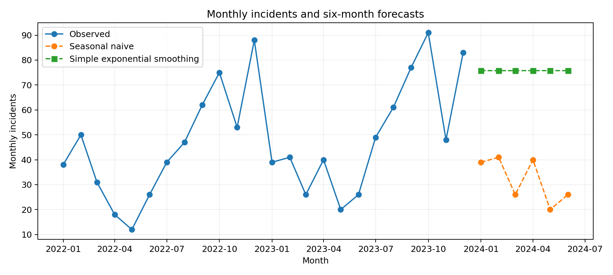

# Airline Delay and Incident Analysis

Academic Unit 8 project by Mei Qiong Xue. The project analyzes flight delays and compares three methods for forecasting monthly incidents.

## Findings
- Decision tree: 73.33% test accuracy (11/15); delayed-flight precision and recall both 77.78%.
- Weather was the dominant fitted feature. Observed delay rates ranged from 6.25% in clear weather to 85.71% in snow.
- Seasonal naive forecasting: 2023 holdout MAE 9.17, versus 18.08 for the prior-year mean and 31.57 for simple exponential smoothing (alpha 0.7).
- Seasonal naive reduced MAE by 49.3% relative to the mean baseline. This is forecast-error improvement, not a reduction in actual incidents.

[Read the PDF report](Unit8_Airline_Risk_Report.pdf) | [Download Word report](Unit8_Airline_Risk_Report.docx)



## Run
```bash
python -m pip install -r requirements.txt
python Unit8_Airline_Risk.py "path/to/course_workbook.xlsx"
```
The workbook must contain the `Data` sheet from the supplied Unit 8 course dataset. The source workbook is required to rerun the analysis. The script writes charts and CSV summaries beside itself. Simple exponential smoothing uses an explicit recurrence initialized at the first observation; it needs no statsmodels dependency.

## Interpretation and limitations
The data contain 50 flight records and 24 distinct monthly incident totals. Monthly totals repeat across flights and must not be summed across flight rows. Classification uses a 70/30 stratified split and random seed 42. Depths 2–5 were inspected on the same test split; therefore the reported accuracy is exploratory. Future work should tune on training folds and reserve a fresh final test set.

The three forecasts use 2022 for training and 2023 for evaluation, then all 24 months for January–June 2024 forecasts. One annual holdout does not establish robust future performance. Simple exponential smoothing models a level and produces a flat forecast; it does not estimate seasonal effects.

Departure-time differences are confounded by weather composition. No causal benefit from rescheduling, crew assignment, or aircraft replacement was measured. Additional data, traffic-volume denominators, and operational testing are needed before deployment.
